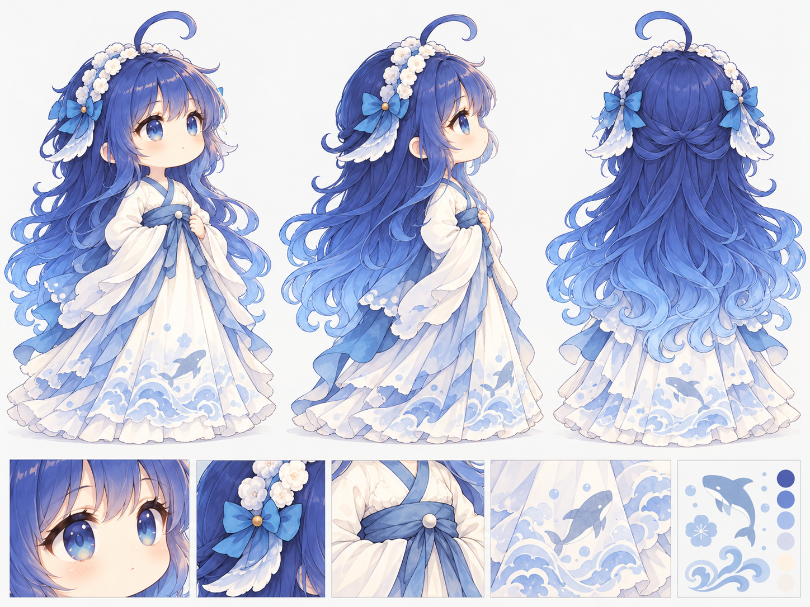

# 角色图的署名与范围（2026-10-26）

## 大肥鱼：本次可以迁入的两张最终图

用户在本次整理中明确提供角色声明，确认大肥鱼形象采用 **CC BY-NC-SA 4.0**，并要求遵守该协议发布。本项目依据此授权陈述，将下列两张项目改编图以同协议分享；不把此结论扩展到未确认绘制者的社区三视图、原始动图或声音。

- 原始鲸鱼娘设计：[上善无形 / 上善](https://space.bilibili.com/4456176)。
- DeepSeek形象二次设计：[ZipZipPipe](https://space.bilibili.com/4168597)。
- 本项目古风/Q版改编、提示词与后期选择：Zqing567，AI辅助生成及画质优化。
- [角色许可声明出处](https://www.bilibili.com/video/BV1tE9XBbErS/)；[作者补充声明](https://www.bilibili.com/opus/1247156596114456581)。
- [固定上游署名记录](https://github.com/shuaizenge/ai-girls/blob/71defe761164407514c1db9bac582d74eab4cdac/NOTICE.md)。
- [CC BY-NC-SA 4.0摘要](https://creativecommons.org/licenses/by-nc-sa/4.0/deed.zh-hans)与[完整条款](https://creativecommons.org/licenses/by-nc-sa/4.0/legalcode.zh-hans)。

处理说明：采用项目第二幕与角色设计作参考，生成独立三视图，再按用户指定优化图归档。站姿展开、不可见背部和衣纹为AI一致性补全；不声称厂商官方设定，也不把原角色设计说成项目原创。

两张图分别保留不同造型方案，不互相替换；均为用户指定最终优化文件夹内容。本次不重新生成或修改像素。

使用时保留上述署名、许可链接和改编说明，限非商业使用；公开改编采用相同协议。本声明仅适用于逐项清单明确批准的这两张图，不是整个仓库的代码/音乐许可。

## 其余五位角色

Claude、GPT、Qwen、Gemini、Grok的拟人设计匹配ZipZipPipe的[《AI娘化》](https://www.pixiv.net/artworks/148186519)。固定上游记录指向作者在[视频简介](https://www.bilibili.com/video/BV1bARXBYEZz/)中开放分享和再创作的说明，但没有确认其统一采用CC BY-NC-SA 4.0。

本次直接访问B站原页面返回412/不可访问，不能把下游记录说成已重新核验原帖。五张优化图及其初版已入索引，公开二进制等待原帖可核查的完整使用说明。提示词已迁入；不给其他角色擅自套大肥鱼协议。

## 证据层级

大肥鱼公开决定采用“用户本次提供的许可声明＋固定上游来源记录＋CC官方条款”；B站原帖本轮未成功直接读取，此限制保留。字体另按随附文件及嵌入许可审查，与角色许可无关。AI生成服务的具体模型版本和优化参数未见记录，保持未知。
