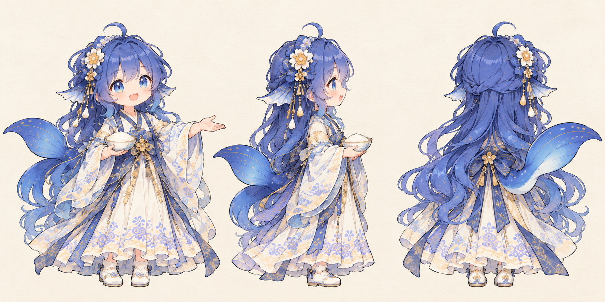

# 大肥鱼换上古风衣服后，怎么还像原来的她？

这次换装，我们想保留蓝发、鲸尾和有点得意的大肥鱼，只把她放进古风吟诗的场景里。麻烦的是，模型有时会连身材、脸和服装风格一起改掉；看起来很精致，却越来越不像原来的角色。

下面按换装、修边、三视图和画质修复的顺序讲。透明立绘来自制作期，三视图则是视频发布后的衍生素材。

## 1. 准备参考图，先把不能变的地方写下来

大肥鱼的原始鲸鱼娘设计来自上善无形／上善，DeepSeek拟人二次设计来自ZipZipPipe。具体原帖和许可见[已有署名记录](../assets/CHARACTER_RIGHTS.md)。项目用过的社区三视图，有些文件的具体绘制者还没核实，因此这里展示的是我们在项目中生成的经典皮立绘，**不是上游画师原图**。

*ROLE-REF：这张经典皮立绘后来直接成为古风换装的输入。先有一个稳定的角色，再改衣服。*

我们反复固定的是这几项：

| 身份特征 | 实际要求 |
| --- | --- |
| 脸与头发 | 蓝眼、蓝色渐变长发、呆毛，表情仍是同一条鱼 |
| 鲸系特征 | 侧鳍、明显分叉的鲸尾，别画成猫耳猫尾 |
| 比例 | Q版，大头短身；早期请求写过约2.8头身，不是成人长腿比例 |
| 服装变化 | 可以换蓝白古风衣，别顺手换脸、换姿态或另加一堆配饰 |

参考图也要分工。角色图负责身份；场景图负责光线、朝向和站位；服装参考负责剪裁。不要只发几张图，再说“综合一下”，让模型自己猜哪张最重要。

跟做时，先选一张五官、头身比清楚的单人图。另外写明想要的姿态、允许修改的服装部位。有正侧背就一起准备；没有的视角，要说明需要模型补全。

## 2. 先做一张立绘，出问题就只修这一项

我们使用的是项目内置的 **Image Gen**。当时记录了参考图和Prompt，工具没有披露底层模型型号、seed、steps等采样参数。

第一轮古风透明立绘要求保留Q版身份，面向右侧、双手背后，蓝白轻汉服，完整头发和鞋子。结果有两个能直接看到的问题：衣服层次比较繁，人物周围还带了一圈泛光，缩进淡色山水后会显得不干净。

| 古风候选 ROLE-01 | 以稳定轮廓重做的 ROLE-02 |
| --- | --- |
|  |  |

第二次改用上一节的经典皮立绘作为编辑目标：**只换衣服，脸、身材、朝向、脚的位置和尾巴都留住。** 原请求中这一段很关键：

> Change ONLY her clothing into simple ivory and muted slate-blue light HANFU… KEEP EXACT SAME chibi body size, head shape, face, eyes, mouth… same right-facing three-quarter standing pose…

完整原文在[早期立绘请求](prompts/02_character-cutouts.md)和[透明边缘修订请求](prompts/02_character-alpha-fix.md)。文件保留了省略部分及完整Prompt。

这一阶段的两张图，用来做早期同景换皮比较；不能把ROLE-02说成最终视频里独立叠加的人物层。正式主场景后来采用整幅定稿图。

### Q版变长、古风变洛丽塔，怎么反馈？

这些方向的跑偏在作者反馈和制作复盘中都出现过。与其笼统地说“不像”，可以逐项指出：

- **身材变长**：重新给Q版参考，写清大头短身，要求保持原图头身比，不只说“可爱一点”。
- **衣服变成繁复裙装**：说清需要古风长衫、宽袖和自然下垂的衣摆；如果蝴蝶结、围裙或层叠裙撑不是目标，就点名去掉，身份特征仍然保留。
- **脸也跟着变了**：把“只改服装”放在前面，明确五官、头发、表情和姿态不改，先完成单人图再放进场景。
- **高光被当作饰品**：说明那是夕阳打在头发上的光，不是新加的珍珠；不要为了解释一处亮点重做全部发饰。

本页ROLE-01展示的是泛光和服装层次问题。成人比例、洛丽塔等错误的对应原图未找回，具体记录见[图片说明](IMAGE_NOTES.md)。

## 3. 透明底要看文件，别只看背景颜色

ROLE-REF和ROLE-02都有实际透明通道。透明立绘的好处，是可以把同一人物放在同一背景上，直接比较衣服和角色气质；不必每次连海、崖壁都重新生成。

那次修订除了“实际透明背景”，还明确要求：

> INSIDE the girl make hair, skin, dress, tail fully opaque solid clean anime painted pixels (alpha255). NO translucent girl, NO missing speckled edges or noisy pinholes…

跟做时检查四件事：

1. PNG确实有透明通道，不是白底或纸色底。
2. 把人物放到浅底、深底各看一次，边缘没有明显白框、蓝色光圈。
3. 头发、衣服和皮肤不是一起变半透明；正常抗锯齿边缘可以有柔和过渡。
4. 按视频里的实际大小缩小看，脸还能认出，尾巴和衣摆没有被裁断。

项目当时还遇到过透明小角色缩小时显颗粒的问题，后改用原生 `Img` 显示再检查。源图边缘与合成显示方式要分开判断，别一看到颗粒就不断重生人物。

## 4. 单人造型选定后，再做正、侧、背

视频发布后，大家想要人物素材，我们才把第二场景中的六个角色分别整理成三视图。**大肥鱼仍是Q版**，不能把其他角色的正常比例套到她身上。

*ROLE-03：基于第二场景主角生成的初版，正面、侧面、背面放在一张图上。纸色背景不是透明底。*

这轮请求没有重新让模型设计一套现代原皮，而是把第二场景定稿作为唯一设计参考，只提取其中的大肥鱼。请求中固定了：

- 同一角色、同样头身比和衣服，不混入其他人的耳朵、尾巴或配饰。
- 三个全身视角，统一身高和脚线，头发、鲸尾、鞋子完整留在画幅里。
- 面部和衣服颜色尽量一致，侧面能看清轮廓，背面不要回头偷看镜头。
- 原画里看不到的背部、遮挡衣纹，需要按可见设计补全，并注明这些部分是推测。

[这张三视图的完整历史Prompt](prompts/02_bigfish-turnaround.md)可以直接阅读。原画主要是场景中的人物姿态，展开成站姿是为了展示服装；结果适合作为创作参考，不是已经逐尺寸校准的建模正交图。

其他五位角色也按各自身份做过独立三视图，完整请求在[六角色记录](../assets/prompts/scene2-turnarounds.json)。跟做时一次只给一个目标角色，不要让模型凭名字猜外形。

## 5. 最后做保守修复，别越修越多

后续优化图由作者挑选并指定为最终素材。其中保留了两套不同造型。下面这张与ROLE-03属于同一类端碗古风方案，经过后续优化后，线条、发丝和服装细节更清楚：

*初版与保留优化方案可上下对照。画幅、尾巴朝向和部分细节也有变化，不能把它描述成逐像素只去噪；[另一套最终造型](../assets/characters/final/诗人大肥鱼形象三视图.png)另行保留。*

这一步使用了作者提供的[完整高保真修复提示词](../assets/prompts/high-fidelity-refinement.txt)。它强调的是：

> 只清理缺乏合理形状、连接关系或材质依据的异常细节，不删除真实且有意义的设计。

实际看图时，优先检查发丝交界、发饰、袖口、裙摆和鲸尾：有没有随机碎纹、粘连、断线，修完有没有变脸、变衣服或多出装饰。不要把“更清楚”理解成把对比度、饱和度和锐化全部拉高。这轮优化的具体模型和采样设置没有记录。

## 自己试做时，先完成一个小循环

1. 准备一张合法身份参考和一张服装/场景参考，分别写清用途。
2. 先生成一张单人古风立绘，只检查身份、比例和服装。
3. 把最明显的问题写具体，一次改一两项；每轮另存原图与Prompt。
4. 选定后再做三视图。要透明底就另行检查，不把纸色图当成已抠好。
5. 最后用保守修复处理杂乱细节，保留修改前后两张，按实际使用尺寸比较。

## 交给Agent复刻

提前准备角色图、想换的服装、最终用途（场景小人/立绘/三视图）和可用的生图工具。Agent可以整理参考、写Prompt、记录版本和检查画幅/透明通道；脸像不像、衣服好不好看，仍由你挑选。

> 参考本教程，用我提供的合法角色图做古风换装。先列出不能改的身份特征，保留Q版比例，一次只做一个角色、一张立绘供我选择。只修明确的问题，选定后再做同身高、同服装的正侧背；透明底和纸色背景分开交付。保存原图、完整Prompt和每轮对照，不覆盖好版本，不编造未记录的模型参数。

需要更完整的任务说明，可直接复制[Agent角色任务](agents/02_character.md)。它是供读者试做的新任务，与前面的历史生图Prompt分开保存。Agent没有生图能力时，先交参考清单和Prompt，交由用户在自己的工具中生成。

### 相关资料

- [本章精选历史Prompt](prompts/02_character-cutouts.md)、[透明边缘修订](prompts/02_character-alpha-fix.md)、[大肥鱼三视图](prompts/02_bigfish-turnaround.md)。
- [图片阶段、许可与裁切说明](IMAGE_NOTES.md)、[逐图来源](image-sources.json)。
- [返回教程导航](README.md) · [下一篇：显卡海崖](03_cliff.md)。
