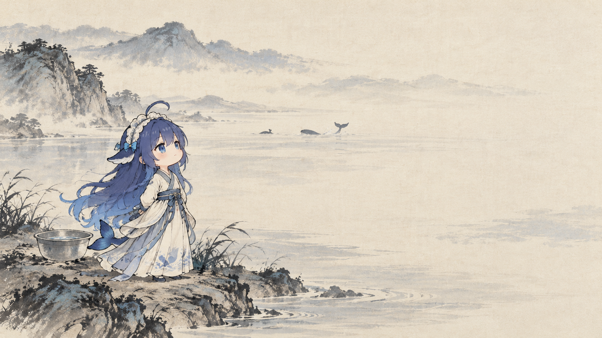
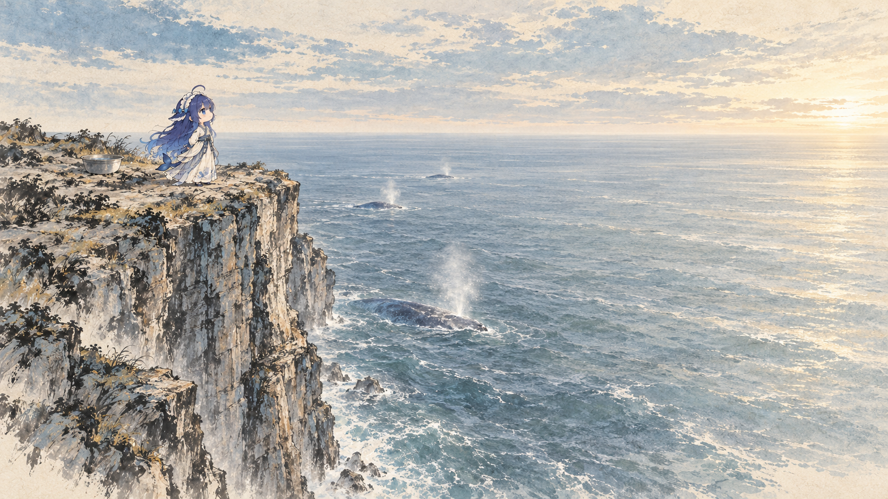
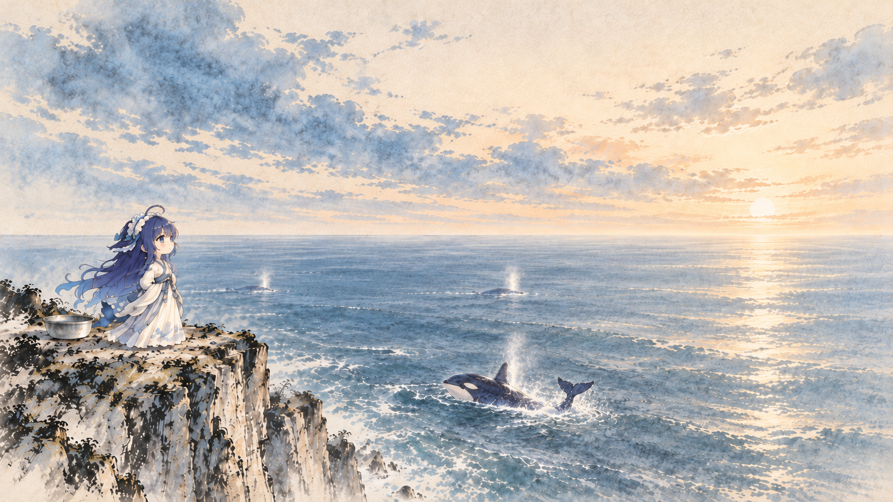
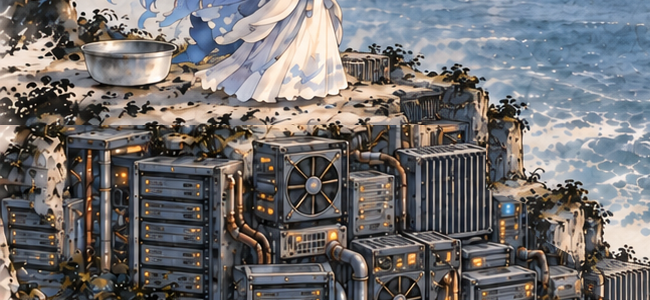
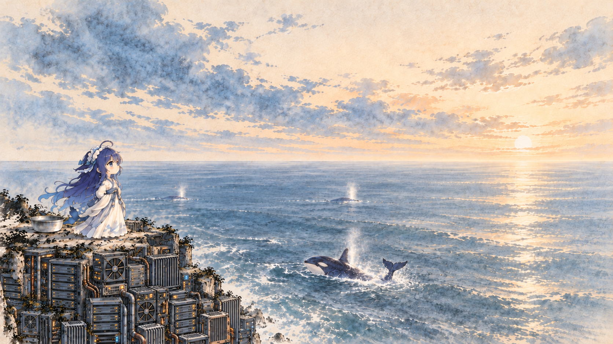

# 显卡海崖是怎么从“河边站着一条鱼”改出来的？

第一场景要让大肥鱼站在高处望海吟诗，脚下的崖壁又藏着显卡。最开始，水墨味道有了，但空间像河岸：鱼离水太近，远处还有山，鲸也没把大海的尺度带出来。

我们先改地理和镜头，再选人物、鲸与留白，最后才把GPU换进崖壁。下面用制作时留下的候选和定稿，说明每轮改了什么。

## 1. 先说清楚：要站在多高的地方，看什么海？

作者当时的反馈很直接：

> 第一场景还是有一些违和感的，像站在河边一样。我们要真正站在礁石海崖上看海，而不是像一般的山水画一样近水远山，海是空阔无垠的，鲸鱼是大大的成群的喷水的，海崖是高高的。

早期Prompt参考过马远画作的空阔水面、倪瓒式疏淡笔墨。问题是，“水墨山水”很容易把近水远山、低岸线一起带过来。我们要保留的是画风和留白，海崖的地理得另外研究。

| 早期水岸方向 CLIFF-01 | 重新研究高断崖后的候选 CLIFF-02 |
| --- | --- |
|  |  |

*左图来自早期V2，右图是后来的V3高崖候选。它们是不同轮次，不是把左图直接拉高或裁切后的结果。*

判断高海崖，不只看有没有石头。画面至少要让人读出：

1. 人物踩着一个能站稳的崖顶平台。
2. 平台下面有明显的垂直崖面，海水在很低的位置。
3. 视线越过海水，能看到连续、开阔的海天线，而非对岸群山围成的湖。

早期请求写过人物占画面高度29%，结果仍画得过大，后续又追加“只把人物线性缩到当前的55%”之类明确要求。[这两轮原始Prompt](prompts/03_riverbank-study.md)都还在。数值表达意图，不代表生图模型一定画到了那个位置。

## 2. 找参考时，把地理、画风和角色拆开

我们查过[清水断崖](https://eng.taiwan.net.tw/m1.aspx?id=2228&sNo=0000208)、[莫赫断崖](https://www.cliffsofmoher.ie/about-the-cliffs-of-moher/)的景观，也看过[NPS鲸类观察资料](https://www.nps.gov/thingstodo/whale-watching-at-point-reyes.htm)。它们分别解决不同问题：

| 输入参考 | 看什么 | 不直接带进画面的东西 |
| --- | --- | --- |
| 真实海崖 | 崖顶、竖直落差、崖脚接海、远海平线 | 景点道路、围栏、特定山形与摄影色调 |
| 古典绘画与已有淡彩稿 | 用墨轻重、空白、远近层次 | 江河两岸的地理关系、古画原构图 |
| 大肥鱼角色图 | 脸、蓝发、鳍耳、鲸尾、Q版比例 | 参考图里的现代服装或背景 |
| 鲸照片 | 鲸背怎样破水、喷息从哪里出来 | 把灰鲸体态直接当成蓝色虎鲸造型 |

本章只链接参考页面，没有复制这些摄影文件。跟做时可以使用自己有权使用的参考图，但仍要逐张写清用途。

V3高海崖请求里，我们直接把边界写进去：

> Reference1 is ONLY geography… Reference2 is ONLY heroine identity. Reference3 is ONLY dilute brushwork/paper/palette, absolutely NOT its riverbank composition or mountains.

随后明确要求左侧高崖、近乎垂直的断面、无沙滩/低岸/湖面/对岸山脉，以及右侧供诗句使用的低信息区。[完整高崖Prompt](prompts/03_high-cliff.md)里有当时的构图位置与参考分工。

## 3. 镜头、人物和文字空区，要一起调整

高崖成立以后，仍可能出现另一种问题：人物小得看不清，崖壁与细碎海浪却特别抢眼。我们又围绕拉近镜头、调整人物位置、改变崖壁占比做了多轮取舍。

现存的近景研究请求，把镜头拉近、人物移到右侧近崖，连脚的位置和人物高度都写了进去：例如人物在画面约75%横向位置、脚在约73%高度，整体高约34%。这些是那次**右崖研究**的要求，不是最后左崖定稿的坐标。

这一阶段也留下了大写意水墨与油彩的对照任务。相关文件是[近景与虎鲸任务](prompts/03_camera-orca-study.md)、[风格研究请求](prompts/03_style-contrast.md)。后者目前只核对到请求，尚未找到对应回片。

后来作者另选了下面这张夕阳底图，回到左侧人物、右侧读诗的关系：

*CLIFF-03：真正进入后续GPU修改的底图。它有作者选定记录与后续改图请求，但原始生成工具和完整Prompt没有记录。*

看这张图时，可以同时检查四处：人物与盆是否站在同一平面；崖顶是否足够高；近鲸和远鲸有没有尺度差；右侧文字区是否被深色物体或浪花占满。

作者画红线指定范围、要求镜头推进的标注原件尚未找回，这里只能依据现存请求讲调整方向。自己反馈时，可以直接画框或写明移动方向。如果要把镜头向前、向上推进，同时说明崖顶与海平线怎样变化，人物、脚下平台、盆和海面的关系也要一起检查。

## 4. 保留水墨气质，再检查鲸像不像虎鲸

当时一个反复出现的问题是：岩石和波纹越画越细，人物也越来越像一张单独的二次元海报。我们不要求所有像素都变成同一种笔触，作者也明确说过，部分反差本身就是趣味；需要控制的是细节有没有压过整个场景。

比较候选时可以这样看：

- 先缩成视频预览大小，看主体与海天是否先被看见。
- 岩壁和海浪是不是全画满了细线，右侧还能不能安心放诗句。
- 蓝色是否只顾着鲜艳，人物与背景已经分成两套光线。
- 脸可以稍清楚，衣纹和岩石不必处处精雕；已经满意的留白别在下一轮被填满。

鲸也要单独指出。早期高崖方向重视“身体接水面、呼吸喷息”，后来近景研究又特别要求蓝色虎鲸的宽分叉尾、眼后白斑和平滑白腹，避免画成带须鲸沟褶的身体。

最终选图里保留了近处跃起的虎鲸、远处鲸背与喷息。它们的出水方式并不相同；不需要三只鲸一起跳，也不能让鲸和水面完全断开，变成悬空的玩具。

## 5. 背景选好后，才把GPU融进崖壁

硬件这一步也不是一次到位。先做过显卡材质、整卡堆叠、岩石嵌机柜等候选，随后要求把崖壁内部零散的硬件改得更密。那次Prompt要求约90%～95%的内部区域由GPU/服务器堆叠占据。这个比例表达修改方向，并非实际测量结果。

**重点只改崖壁内部。** 人物、盆、天空、海平线、鲸和整体颜色都要求不动。[加密GPU的完整请求](prompts/03_gpu-density.md)可以看到这些限制。

加密后又发现脚下站面的问题：大肥鱼应当站在岩石上，而不是直接踩着电路板。因此下一轮要求恢复连续的薄石台，在外缘留少量自然石舌，主体仍是密集硬件。

| GPU密集版的脚下 | 最终背景的脚下 |
| --- | --- |
|  |  |

*同一区域的真实裁切，只方便看站面与硬件关系，没有补画或重新生成。完整图在[密集版](images/cliff-gpu-dense.png)与[最终背景](images/cliff-gpu-final.png)。*

这轮最有用的要求是：

> She must stand on solid rocky ground, not on circuit boards or GPU cases. Keep the dense GPUs immediately BELOW this thin stone cap.

收到改图后，我们用局部合成把崖壁区域放回已选底图，保留其他区域，再检查天空、人物、盆和外海是否变化。[恢复石台的完整Prompt](prompts/03_rock-platform.md)及资料区保留了这个步骤。

## 6. 最后定稿：它是一张静态背景

这张图负责稳定的海天、角色和崖壁。金币、字幕、心理气泡后来单独叠加。首发视频没有使用Gemini生成的显卡动态，也没有让这张图在播放时自动发光或运转。

跟做时，选定主图后先停下来，检查人物、地理、留白是否都成立，再做动效。定稿原图为1672×941，4K成片由后续工程合成输出；导出尺寸不会增加原图细节。

## 交给Agent复刻

准备角色参考、合法景观参考、画幅和字幕预留区。Agent可以整理参考作用、给候选、保存Prompt和检查局部变化；你来选构图、画风、人物大小和硬件密度。

> 参考本教程和历史Prompt，用我的合法参考做高海崖场景。先确认崖顶、垂直落差、外海与人物站位，不要先堆显卡。一次给少量候选让我选，记录参考图用途。底图通过后只改崖壁材质，保留人物脚下石台、天空、盆和鲸；每轮另存原图和完整Prompt，给出前后对照。不要生成视频、改既有工程或把未执行的动效当成果。

完整任务见[Agent海崖任务](agents/03_cliff.md)，这是本轮整理的跟做说明。没有生图工具时先输出任务卡和参考清单，不虚构已生成的图片。

### 相关资料

- [早期水岸与人物缩小](prompts/03_riverbank-study.md) · [高断崖](prompts/03_high-cliff.md) · [GPU加密](prompts/03_gpu-density.md) · [恢复石台](prompts/03_rock-platform.md)。
- [图片阶段与署名](IMAGE_NOTES.md)、[完整图像来源](image-sources.json)。具体底层生图型号与采样参数未披露的地方，均保留未知。
- 最终代码入口是 [`GpuBackdrop.tsx`](../editor/src/GpuBackdrop.tsx)，直接加载选定PNG；局部合成发生在制作阶段，不是每一帧重画崖壁。
- [返回教程导航](README.md) · [上一篇：角色形象](02_character.md)。
