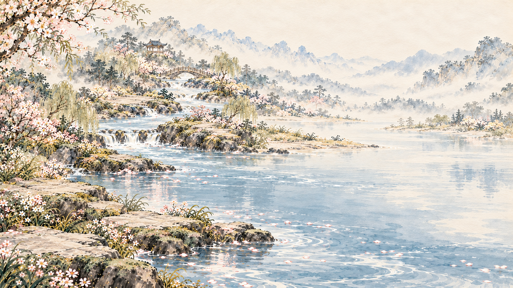
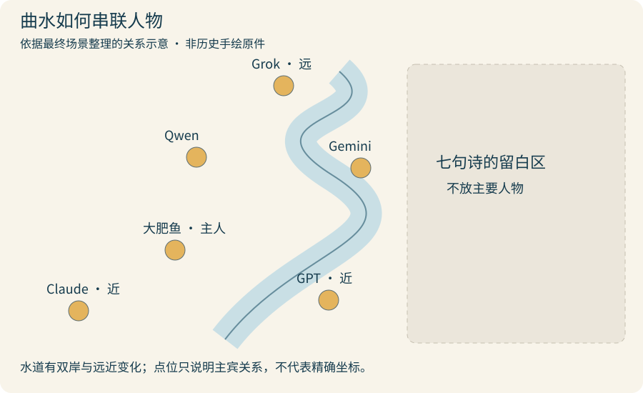
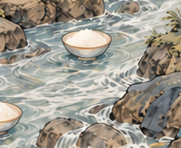

# “曲水流饭”怎么画，才不像湖边合影？

第二幕要把“Claude，GPT，将进 token”变成一场郑重其事的饭局。我们借用曲水流觞的关系，让白饭碗沿溪漂下来，大肥鱼站在岸边邀请朋友。最难的不是把六个人画齐，而是让水道、坐席和动作真的连起来。

## 1. 先确定这场聚会在做什么

只写“古风山水，六个角色坐在水边”，模型很容易给一片湖，再把人物排成合影。作者想要的是一条能看出流向的窄溪，把不同位置的人串成诗会。

我们参考《兰亭修禊图》的空间组织，并研究水平翻转后的左实右虚关系：左下是主人与近席，中景沿溪散坐，右侧留给七句诗。借的是水如何组织人物，不是把古画扫描贴进视频。

*这张是实际留下的早期无人河景候选，用来比较水面尺度与装饰密度；它不是“湖边群像”错误图，也没有进入最终第二幕。湖畔群像、作者红色手绘河道的对应原件本轮未找回，相关经历保留在[制作复盘](../docs/EXPERIENCE.md#3-场景-b-从湖畔群像改为曲水流饭)。*

自己试做时，先用一条线标水道、几个点标坐席，再画字幕区。只要这三种关系还不清楚，就先别加花树、亭子和衣纹。

## 2. 把“一条窄溪”写成看得见的要求

这轮使用内置 **Image Gen**，参考角色图控制身份，构图由单独的文字说明控制。具体底层模型与采样参数没有记录。

三张构图候选分别尝试舒展S形、两次回折、斜向山溪。我们把双岸、宽度、入画和出画位置都写出来。A3请求中的一段是：

> 必须清楚看见一条窄溪的“两条岸线”……宽度为画幅4–8%，有深浅和宽窄变化。溪外全是干燥草坡、低岸台、细石与少量疏树，不允许大湖、大片平铺水面、宽阔湖湾、水平线湖岸。

[完整三张构图Prompt和饭碗修订](prompts/04_garden-layout.md)保留了实际坐标、角色分工与候选说明。百分比是请求中的构图意图，不是生图工具一定能精确执行的约束。

收到候选后先看：两条岸线能不能一路追下去？弯道外是不是陆地？溪水有没有突然扩成一片湖？如果这几处不对，只改水道，不急着修每个人的脸。

## 3. 先排主宾，再让其他人沿溪退远

*本轮根据定稿整理的关系示意，不是作者当年的手绘图，也不展示其他角色完整形象。点位仅帮助理解位置与远近，不是精确坐标图。*

安排人物时，分成两个层次就比较容易：

- **近景三人**：大肥鱼是主人，一手端饭、一手邀请；Claude和GPT各坐在自己的岸边，视线朝向主人，三人之间能看见溪流和空隙。
- **中远景三人**：Qwen、Gemini、Grok沿不同岸段散坐，体量随距离缩小；不要挤成第二排，也不要占右侧文字区。

参考图中的角色排版不能决定这张画的构图。每张输入图要写清用途：哪张只锁发色与衣服，哪张是唯一编辑底图，哪张只帮助理解水道。多角色修订时，直接用位置、发色和动作指定对象，别只写一个名字。

## 4. 作者选好底图后，只把大肥鱼改成站姿Q版

早期三张构图请求把人物往古代仕女画比例转译，曾写过约1:5或1:6头身。这是探索阶段；作者选定A3后，明确要求“大肥鱼改Q版、站起来，其他AI娘不变”。最终不能继续沿用前面的修长比例。

*最终场景的主角局部裁切，方便检查端碗、邀请手势和脚下站面；不是后来生成的独立立绘。*

局部请求把修改对象与不动区域分别写明：

> 只改变画面左下主戏区中间的蓝发鲸尾主角“大肥鱼”……把她改成站立的Q版形象。其它五位AI娘……全部保持原有脸型、头身比例、发型、服饰、坐姿、位置、大小和神情，不得一起变成Q版。

第二张参考只借Q版脸、蓝发、鳍耳和比例，明确排除女仆裙、金币、盆和气泡边框。站起来后露出的原坐席区域，只补相邻草坡和石岸。完整请求见[Q版站姿定稿修订](prompts/04_garden-chibi.md)。

检查时按头、手、脚走一遍：脸还是她吗？两只手是否各接一条自然的手臂？饭碗有没有悬空？两脚是不是落在岸上？不要只因为衣服更精细就接受人物漂在水里的版本。

## 5. 白饭碗是笑点，也要符合这条溪的空间

*这里只展示下游局部，不是全画面计数图。最终记录保留水中5只饭碗，主角手中另有1碗。*

饭碗数量在几轮请求中变过：

| 阶段 | 请求与实际结果 |
| --- | --- |
| 构图候选A2 | 请求4只漂碗；上游画多后，另做删碗修订，记录为4只 |
| 构图候选A3 | 同样请求4只，实际查看记录为5只 |
| 作者选定后的站姿修订 | 明确保留现有5只漂碗，不再为数量重画整图 |

定稿保留了选中画面的5只漂碗，没有为凑到4只再改整图。自己做时也可以先决定：数量是否承担叙事功能？若只是点缀，水岸、近大远小和白饭是否可辨，往往比多一只少一只更值得先修。

## 6. 最后纠正身份与颜色，留白别再填回去

后续只针对Gemini、Grok细化身份：前者要与右下白发淡紫的GPT分开，保留蓝紫粉渐变、猫耳猫尾与星饰；后者保持金发双马尾、黑金配酒红的方向。大肥鱼和其他三人、溪流、饭碗、右侧留白都列为不改区域。

[完整两角色修订与分辨率重试](prompts/04_garden-identities.md)也记录了一次没达到目标的尝试：虽然请求3840×2160，实际回片仍为1672×941，重试还提高了全图对比度，于是没有采用重试。Prompt里写了4K，不等于拿到的文件就是4K。

正式背景由 [`PoetryGarden`](../editor/src/LowerHalf.tsx) 加载 `lower-half/B-approved-20261022.png`。这是整幅静态画，溪流里的饭碗并没有在代码里沿水漂动。七句字幕由后期叠加；右侧留白也来自原构图，不靠贴一个白色矩形临时遮人。

## 交给Agent复刻

准备有权使用的角色参考、简单水道草图、画幅和文字预留区，并提供可用生图工具。Agent能整理参考分工、写小批候选、按区域修订和记录版本；构图、角色身份与画风仍要你挑。

> 按本教程做一张曲水诗会图。先画窄溪双岸、主宾与字幕区，给少量构图候选；别先堆人物细节。参考图分别用于身份和构图。底图选定后逐个修角色，大肥鱼保持Q版，其余角色按各自参考；检查脚落在岸上、手臂自然、饭碗在水里。明确最终碗数与右侧留白，保存每轮原图和完整Prompt，逐项标注未达到的要求，不把请求尺寸当实际尺寸。

详细准备项见[Agent曲水任务](agents/04_garden.md)。

### 相关资料

- [真实历史Prompt](prompts/04_garden-layout.md) · [主角修订](prompts/04_garden-chibi.md) · [后续身份修订](prompts/04_garden-identities.md)。
- [图片与示意说明](IMAGE_NOTES.md)；其他角色完整图片仍按[现有公开范围](../assets/CHARACTER_RIGHTS.md#其余五位角色)处理，本章没有新增上传。
- [上一篇：显卡海崖](03_cliff.md) · [下一篇：字幕](05_captions.md) · [教程导航](README.md)。
