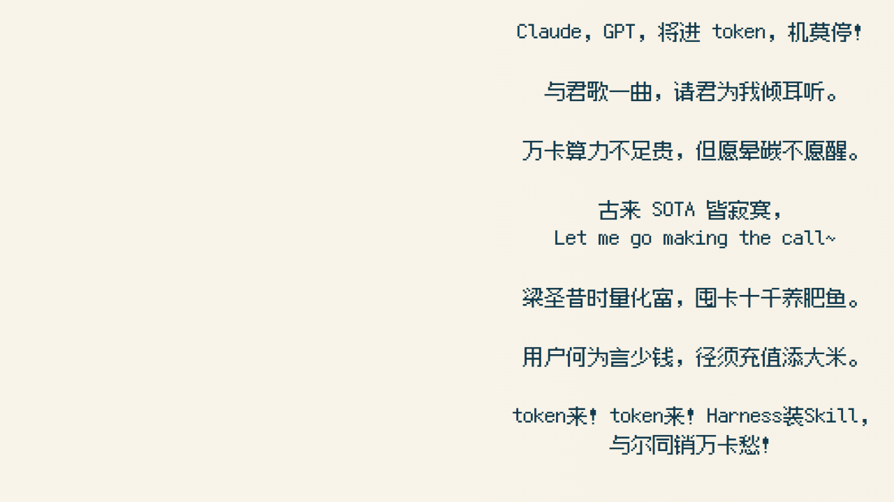

# 诗句怎样一句句出现，读完以后又留在画里？

这条视频的字幕要让观众跟着声音走，也要在一幕结束时读到完整的诗。逐句替换会把前文抹掉，开头铺满又没有推进感，所以最后采用：轮到一句才出现，读过以后留在固定位置。

## 1. 先把最后一屏排好，再做动画

第一幕五句，第二幕七句。先检查每幕所有文字都出现时能不能放下，再倒回第一句安排入场，比边播边挪字更稳。



*本轮用未改动的 `Poem` 组件重绘字幕层，隐藏背景和其他叠加物，便于看排版；不是从正式影片截出的画面。字体、位置、分行和入场逻辑来自现有工程。*

第二幕有七句，其中L09、L12各分成两行，实际要排九行。把“七句”理解成“七行”，最后两句就容易挤到画面外。

## 2. 用像素字体，但要把英文一起试进去

作者当时的要求是“像素类的字体，要有‘人工智能’感”，也明确不想用过于呆板规范的字体。最终用的是 **缝合像素字体 Fusion Pixel 12px**；仓库另保留 **Cubic 11** 和 **霞鹜文楷屏幕阅读版**，供试排和历史工作坊使用。

跟做时别只试中文。把 `token`、`Claude`、`GPT`、`SOTA`、`Harness装Skill` 和标点一起放进去，看大小写、空格与字距是否协调。最终字体通过 [`Fonts.ts`](../editor/src/Fonts.ts) 从本地文件加载，并等待加载结束再渲染，避免截图先用了系统替代字体。

当前正式 `Poem` 优先读取布局文件里的 `font`，A、B都选 `F1`。仅修改调用处的 `font` 属性，不一定能换掉正式字体；复刻时要同时看[布局配置](../editor/src/selected-layout.json)。字体许可见[署名表](../assets/ATTRIBUTIONS.md)。

## 3. 文字与画面各有空间，别临时糊一块白底

以下是正式1280×720逻辑画布上的参数。4K输出时由工程整体放大，不需要再把数字乘三写回配置。

| 参数 | 海崖A | 曲水B |
| --- | --- | --- |
| 诗句左边位置X | 430 | 734 |
| 第一条诗句Y | 170 | 24 |
| 文字区宽度 | 800 | 525 |
| 字号 | 36 | 31 |
| 每句基础间隔 | 106 | 85 |
| 对齐 | 居中 | 居中 |
| 渐变底最高配置透明度 | 28% | 15% |

淡纸色渐变用来缓解背景干扰，边缘逐渐过渡。它建立在原图已经留白的基础上，不能拿来挽救被人物、树枝占满的字幕区。换图时先看人脸、鲸和饭碗有没有进入文字区，再决定要不要调遮罩。

第二幕多行的排法是固定位置加补偿：某句之前每多出一行，后续位置再下移 `字号+10`，即41像素。文字始终留在自己的位置；当前没有自动重排或飞入侧栏的效果。

## 4. 用选好的声音定时，别把十二句平均分配

真正影响同步的是 [`captions.json`](../editor/src/captions.json) 中每句的 `startFrame`、`endFrame`，以及最终混音。换了配音或剪掉一段静默，后面所有时点都可能需要复查。

例如第一句保存为：

```json
{
  "id": "L01",
  "scene": "A",
  "slot": 0,
  "text": "君不见，用户 token 天上来，落入铁盆不复回。",
  "startFrame": 97,
  "endFrame": 325
}
```

30fps下，第97帧约为3.23秒。`slot` 决定位置，帧点决定什么时候出现；显示用字单独保存，不把配音里辅助发音的“招炫”“寰复来”写进字幕。

先按句试听并找起点，再在视频里逐处看嘴里的声音与屏上第一批字是否接得上。ASR可以帮忙定位，不能替你判断气口和艺术节奏。当前记录有相邻句边界重叠1帧的情况，不应只为了凑整齐就自动重分时间。

## 5. 入场有变化，落定以后保持安静


*上为第一句出现后，下为本幕五句齐全。两张都是本轮字幕层重绘，使用相同固定位置。*

正式片以 `mixed` 模式交替使用三种进入方式，每句视觉入场进度为18帧，约0.6秒：

- **fade**：整句透明度从0到1。
- **wipe**：用CSS `clipPath` 从左向右揭开整句。
- **pixel**：按字符逐步显示，保留整句占位，后面的字不会把前面的字挤走。

这里的“擦写”没有模拟毛笔笔画，“像素显现”也不是逐像素溶解。核心逻辑在 [`Poem`](../editor/src/CaptionStudy.tsx)：

```ts
const entry = Math.min(1, Math.max(0, (globalFrame - c.startFrame) / 18));
```

[`getLineState`](../editor/src/caption-model.mjs) 另有 `unseen / entering / active / archiving / archived` 状态，其中 `entering` 是10帧。它给出语义状态，实际视觉效果使用上面的18帧进度；不能只看到状态叫“归档”就说文字做了归档位移动画。

## 6. 检查末态和切幕，比只看第一句更重要

按这几个位置检查就能抓到大部分问题：

1. 每幕第一句：字体是否加载、入场是否切字。
2. 最长中英混排句：换行后是否超宽，标点是否落到奇怪的位置。
3. 海崖末态与曲水末态：五句、七句都保留，第二幕九行没有重叠或出界。
4. 第1060帧附近切幕：A文字随A画面结束，B文字按自己的时点出现，不提前铺满。
5. 片尾追加区间：完整诗句继续保留，不因旧时长到点而消失。

换字体、改分行或调整时点后，重新检查对应画面。

## 交给Agent复刻

准备最终显示稿、选好的声音、画幅、背景和可用字体。Agent可以标句、排末态、按帧实现入场并导出检查图；字体气质、可读性和声音节奏由你确认。

> 按本教程做累积字幕。先排出每幕全部文字的末态，保留诗稿原字；长句明确分行，英文一起试排。依据最终音频标记起止帧，入场后留在固定位置。给淡入、横向揭示、字符显现少量对照，检查字体加载、边界、遮挡和两幕交接；交付时间表、配置、关键帧与可编辑代码，不改已有配音。

详细任务见[Agent字幕任务](agents/05_captions.md)。

### 相关资料

- [句稿与时点](../editor/src/captions.json) · [布局参数](../editor/src/selected-layout.json) · [入场组件](../editor/src/CaptionStudy.tsx)。
- 本章没有生图Prompt：文字由字体与代码合成，不交给生图模型画字。
- [上一篇：曲水流饭](04_garden.md) · [下一篇：心理气泡与动效](06_motion.md) · [教程导航](README.md)。
