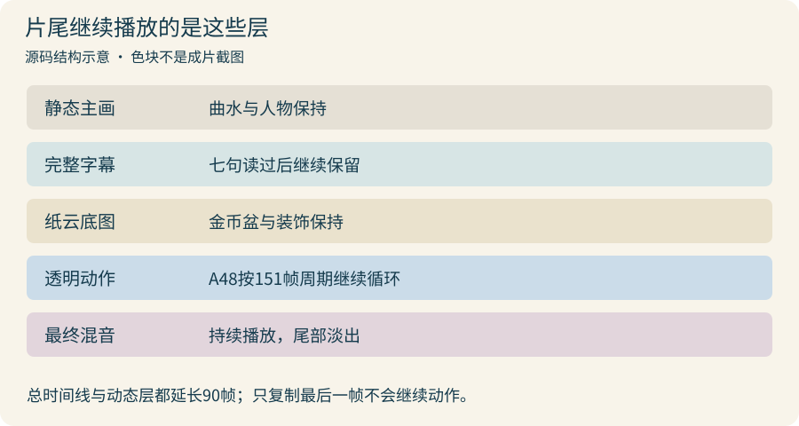

# 心理气泡、表情包和金币，分别怎么动？

画里的大肥鱼一本正经地吟诗，左上角却在想着白饭、算力和充值。我们把这些小剧场单独叠在静态主场景上：需要变化时换内容，其他时候让观众安心看画、听诗。

## 1. 先按诗句选笑点，再决定用什么素材

经典女仆皮出现在古风画里，本来就有反差。作者接受这种混用，前提是仍能认出大肥鱼；没必要把每张梗图都重画成同一种水墨笔触。

正式片的心理活动大致这样衔接，具体时点由 [`cue-model.ts`](../editor/src/cue-model.ts) 从字幕与声音记录中取得：

| 位置 | 心理活动 | 实际做法 |
| --- | --- | --- |
| 海崖L02 | 朝暮炫饭 | 静态整合插图 |
| 海崖L04 | 空盆提醒用户添token | 静态提醒图；旧工作坊另有小原皮动态方案 |
| 海崖L05 | 唱歌偷懒 | 纸云框＋透明唱歌视频循环 |
| 曲水L08后段 | 晕碳、白饭梦 | 静态梦泡，约在本句进度43%进入 |
| 曲水唱段 | 跟着歌唱 | 透明唱歌视频循环，开始于全片第1770帧 |
| 曲水L10、L11 | 粮仓、充值添米 | 依次切换静态整合图 |
| 曲水L12到片尾 | 得意地招token | 纸云金币底图＋抠出的原A48动作循环 |

先判断笑点要表达什么，再找素材。不要因为手里有一张动图，就让它在整首诗里反复抢镜。

## 2. 气泡要像一个小画面，不是给梗图套个框

早期尝试过纸云容器再嵌原图，后来又将人物、白饭、显卡和纸纹重新组织为完整插图。原来的矩形边界若还露在云里，往往比主画面的风格差异更显突兀。

| 粮仓心理图 | 片尾运动承载底图 |
| --- | --- |
|  |  |

*这两张是制作期实际素材，不是本轮新画。右图留空的左侧需要另叠运动角色，单独看底图当然不会动。*

第二幕的心理区是320×240，即4:3；这两张原素材为1448×1086，保持同一比例后缩小。粮仓图里人物、米袋和显卡已经整合，片尾底图则刻意空出左侧，供原动态角色活动。

可以参考[早期纸云完整Prompt](../assets/prompts/upper-candidate-prompts.json)中的 `thought-paper`，以及[4:3重构规格](prompts/06_cloud-reconstruction-spec.md)。后者是当时留下的交接复现规格，**不是逐字生图调用日志**。Image Gen底层型号与采样参数未知，不能补成某个特定模型。

自己试做时，提前写清画幅、人物区、道具区、透明边缘、是否需要文字。气泡内容尽量不依赖小字；确实要加字，就在后期用字体排，别让生图模型承担准确排字。

## 3. 静图按句换，动态按自己的周期循环

[`ThoughtBubble`](../editor/src/UpperHalf.tsx) 和 [`LowerThought`](../editor/src/LowerHalf.tsx) 根据当前帧选内容，切换附近用淡入淡出和纸底过渡。它们不是固定每5秒轮播，也没有让模型实时理解诗句。

*本轮依据最终组件绘制的分层示意；色块代表图层，不是成片截图。*

唱歌视频使用180帧循环；片尾A48使用151帧循环。先用 `Sequence` 对齐动作开始，再用 `Loop` 让局部帧数重复。视频层设为 `muted`，全片声音由完整混音统一播放，避免原视频声音叠出第二份。

循环接缝仍要自己看：第一帧和最后一帧的姿态差很大时，循环会跳；不要只确认文件能播放，就认为已经接得自然。

## 4. GIF去背景：保留原动作，单独求透明度

片尾使用原始A48 GIF的动作，经过 **MODNet，CPU fp32** 前景分离，得到透明WebM，再叠到纸云底图里。历史记录为300×370、30fps、151帧，其中46个唯一画面需要推断，其余重复画面复用结果。

实际处理顺序是：

1. FFmpeg把GIF解码到30fps帧序列，保留原有停留节奏。
2. MODNet对不同画面推断前景透明度，重复帧复用，不另造一个新动作。
3. 将透明帧编码为VP9 WebM，历史脚本使用 `yuva420p`、`-auto-alt-ref 0`、CRF18。
4. 在深浅两种底上检查头发、袖口和尾巴边缘，再放回实际尺寸看。
5. 用 `OffthreadVideo transparent` 叠加，必要时用遮罩限制边缘溢出。

代码见 [`matte-a48-cpu-v21.mjs`](../editor/matte-a48-cpu-v21.mjs)。它依赖本地MODNet模型、FFmpeg及原GIF，不是播放工程前必须重跑的步骤；当前模型推断和抠图效果，也不替原GIF建立再分发许可。

普通浏览器直接播放WebM时的黑底不一定说明透明丢失。检查解码器是否读取alpha，再看实际合成结果；也不要把边缘裁软就当成已经抠出了人物。

## 5. 金币用代码飞，不必让模型生成整段视频

第一句的token雨用 [`TokenRain`](../editor/src/UpperHalf.tsx) 实现，共24枚。每枚都有自己的起飞时间、飞行时长和落点：从画面上方落下，Y用二次曲线加速，X略有偏移，旋转与横向缩放制造翻面感；到盆里以后固定成堆，再加小闪光。

位置要按当前帧直接计算。Remotion渲染时可能跳着取帧，不能依赖“上一帧加一点速度”或不固定的随机数，否则预览与导出可能不同。

跟做一个最小版本：先让一枚金币准确落盆，确认盆口前后遮挡，再铺成少量错开的轨迹。不要上来堆几百枚，也别让金币穿过鱼脸或落在盆外。

## 6. 人物复杂表演做坏了，就换方法

当时曾尝试用二维位图拉伸模拟“token来”举臂，结果形体崩坏。问题在于整块图片被扭动，并没有可独立控制的关节。继续调拉伸幅度，很难把它变成可靠的人物表演。

这类动作可以换成合适的动态素材、拆分角色部件制作，或尝试图生视频。当前首发选择了原A48动作，没有把错误拉伸继续塞进定稿。对应错误原图没有作为公开附件，本章不新造一张“历史失败截图”。

显卡满载也做过Gemini图生视频尝试。完整[8秒实验Prompt](prompts/06_gemini-gpu-experiment.md)限制固定机位、只转扇叶、只亮原机箱的小灯，人物、盆、鲸和海天不动。作者认为效果可继续探索，但明确决定第一版不用；正式 `GpuBackdrop` 仍是一张静态图，不能写成GPU已在片中运转。

## 7. 片尾留白，动作和音乐都要跟着延长

最初补尾声时，作者看到的是画面突然停住，BGM也断了。解决方法不是重复最后一帧，而是让第二幕继续被渲染，让 `LowerThought` 存活到正式总片长，并使用已延长、淡出的混音文件。

正式时长由2523帧延长到2613帧，追加90帧，正好3秒。`FullReview` 把新总时长传给心理活动层，A48在这段时间仍循环；字幕与背景保持，音乐自然收住。单独改旧配置中的一个数字，或者把静态末帧复制90次，都不能完成这件事。

检查尾声时至少比较追加区间内几张相隔半秒的画面，并试听接点到结束：人物动作是否还变，音乐有没有在旧结束点骤断，最后是否真的淡下去。当前工程和已有QC已保留这个修正，本轮没有重做成片。

## 交给Agent复刻

先提供诗句时间表、允许使用的静图/GIF/视频及目标画幅。Agent可以整理切换点、抠图与循环、金币轨迹和关键帧；笑点是否合适、循环是否自然、边缘是否舒服需要你看。

> 按本教程把心理活动作为独立叠加层。先列每句使用静图、原动态还是生成视频；代码金币按帧计算，动态视频静音并按自身周期循环。保留原动作与版本，检查透明边缘和背景遮挡。末尾延长约3秒时，同时延长主时间线、动态层存活区间和混音，别冻结末帧。未采用的图生视频单独标注，不改已定稿工程，不上传未获许可的原动图。

详细任务见[Agent动效任务](agents/06_motion.md)。

### 相关资料

- [完整组件](../editor/src/LowerHalf.tsx) · [金币与第一幕气泡](../editor/src/UpperHalf.tsx) · [时点来源](../editor/src/cue-model.ts)。
- [图片阶段与许可](IMAGE_NOTES.md) · [历史证据边界](../docs/LESSONS_WITH_EVIDENCE.md#6意象与动画选对可控的层)。
- [上一篇：字幕](05_captions.md) · [下一篇：合成与导出](07_compositing.md) · [教程导航](README.md)。
