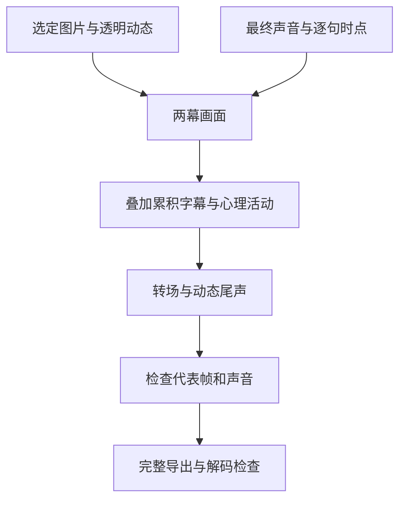

# 两张主画、十二句诗和声音，最后怎么合成87.1秒？

前面几篇把图片、配音和动效分别做好了，最后要让它们共用同一条时间线。我们用 **React 19.2.3 + Remotion 4.0.537** 组织图层，按帧输出。它适合这次需要精确控制字幕、气泡、循环和声音的做法；普通剪辑软件也能按同样思路分层完成。

## 1. 先把画面分成能独立控制的层

正式工程把画面拆开，每层单独控制：

| 层 | 内容 | 主要入口 |
| --- | --- | --- |
| 主场景 | 海崖、曲水，两张静态整图 | `GpuBackdrop`、`PoetryGarden` |
| 文字 | 标题、作者、逐句累积的诗 | `Poem` |
| 程序动画 | token落盆、翻面、小闪光 | `TokenRain` |
| 心理活动 | 纸云、白饭、粮仓、充值、透明动态 | `ThoughtBubble`、`LowerThought` |
| 转场 | 米白覆盖层淡入淡出 | `FullReview` |
| 声音 | 已完成的配音、音乐、歌曲、音效混音 | `FullReview` 中一条 `Audio` |



这张图只保留制作顺序。详细代码关系见[技术模块](../docs/PRODUCTION_MODULES.md)，不需要一开始就把所有组件名画成一张大图。

## 2. 用正式入口统一时长，不从旧预览导出

打开Studio后选择 **`JinToken-Final`**。正式合同是：

| 项目 | 正式值 |
| --- | --- |
| 逻辑画布 | 1280×720 |
| 帧率 | 30fps |
| 总帧数 | 2613帧，0–2612 |
| 时长 | 87.1秒 |
| 第二幕开始 | 第1060帧，约35.33秒 |
| 追加尾声 | 第2523–2612帧，90帧 |
| 音轨 | `audio/full_mix_final_tail3s.wav` |

[`Root.tsx`](../editor/src/Root.tsx) 是正式入口依据。旧 `V3-Review` 和 `upper-half.json` 仍保留2523帧的历史长度，不应拿它们代替最终87.1秒。完整入口会把实际总时长传给尾声动态层。

自己试做时，先固定帧率，再把声音时点换成帧。每个叠加层读取同一时钟；已有最终声音不要在两个场景各放一遍，否则会重叠、错位或重新起播。

## 3. 两幕切换轻一点，声音保持连贯

制作时讨论过海水转溪水的意象，正式实现选了更简单的米白覆盖。海崖在第1060帧切到曲水，覆盖层在附近先淡入、再淡出，掩住两幅静画的直接跳切。

源代码使用的四个帧点为 `cut-10、cut-1、cut、cut+8`，透明度依次 `0、1、1、0`。这是纸色过渡，没有水体模拟或生成式变形。

声音则播放已做好的完整混音。配音气口、英文唱段、BGM让位、金币音效和片尾淡出在音频制作时完成；`FullReview` 不会临时自动压低BGM，也不会在导出时帮你修不自然的拼接。混音经验见[配音篇](01_voice.md#6-把音频接成完整视频)。

## 4. 先选一条能运行的路径

公开仓库提供代码、字体、教程图片和提示词，不包含全部原片音乐、人声与动图。因此下面两条路径要分开选：

| 你手里有什么 | 用哪条路径 |
| --- | --- |
| 只有公开仓库，想先看看结构 | 公开占位演示：程序图形、循环圆点和静音，保留真实字幕与时间线 |
| 已合法持有作者原运行素材 | 本地补齐19项输入，按清单核对后复现原效果 |
| 想制作自己的视频 | 先运行占位演示，再在独立副本里替换自己的图片、声音与时点 |

第一次建议跑公开演示。Python需3.10+，Node按[package.json](../editor/package.json)的 `engines` 安装；`ffmpeg` 与 `ffprobe` 要在命令行可用。从仓库根目录执行：

```sh
python -m pip install Pillow
cd projects/jin-token/editor
npm ci
cd ../../..
python tools/make_public_demo.py
cd projects/jin-token/editor
npx remotion studio --no-open --public-dir ../../../.local-staging/demo-public
```

打开终端返回的URL，选 `JinToken-Final`，先看两幕文字和片尾圆点是否持续。DEMO不是公开版原片，静音和占位画面是预期行为。

合法本地原素材的干跑、补齐命令见[工程README的B路径](../editor/README.md#b作者本地合法素材复现)。工具只检查和导入你已有的文件，不代替你下载原歌曲或社区动图，也不改变公开权限。

## 5. 先出检查版，再出4K

以下命令都从 `projects/jin-token/editor` 执行，输出名必须是新文件。先用720p占位检查：

```sh
node render-submission-4k.cjs --scale 1 --public-dir ../../../.local-staging/demo-public --output ../../../.local-staging/tutorial-demo-check.mp4
```

合法原媒体已补齐后，4K导出为：

```sh
node render-submission-4k.cjs --public-dir ../../../.local-staging/private-public --output ../../../.local-staging/tutorial-master-4k.mp4
```

导出器默认 `scale=3`，输出3840×2160，H.264、CRF12、`yuv420p`、BT.709；音频AAC320k。原场景位图约1672×941，4K合成能保留字体和叠加层的输出精度，不会让背景凭空长出原生4K细节。

每个输出文件有独立的 `-work` 工作目录，临时文件跟随输出位置。需要避免C盘缓存压力时，把 `--output` 指到空间充足的磁盘；不要为省空间直接清空其他任务的缓存。脚本拒绝覆盖已有成片，重跑换一个文件名。

## 6. 检查画面、声音和尾声，再确认完整解码

先人工检查这些位置：

1. 开场标题和第一句：字体、声音、金币落点。
2. 第一幕五句齐全、第二幕七句齐全：长句不出界，人物和饭碗不被遮挡。
3. 第1060帧附近：米白转场、场景切换与朗诵衔接。
4. 第1770帧附近：歌曲与心理唱歌画面是否接得上。
5. 旧结束点84.1秒到新结束87.1秒：动作继续，音乐没有骤停，完整诗句保留。

只查追加区间可用 `--frames 2523-2612`，但那是片段检查，不能称为完整成片已验收。完整输出后，从仓库根目录用现有QC工具：

```sh
python -m pip install -r tools/requirements-qc.txt
python tools/qc_video.py .local-staging/tutorial-master-4k.mp4 --audio-reference .local-staging/private-public/audio/full_mix_final_tail3s.wav --report .local-staging/tutorial-master-qc.json
```

占位片用对应文件名与 `--demo`，不拿静音去对原声轨。工具会检查完整解码、参数、音轨对齐和尾声运动；最终仍需自己从头看、戴耳机听。哈希用于核对输入与保存版本，不能代替画面和听感。

本项目此前已用合法本地输入重渲染完整4K，并与投稿定稿达到字节一致，细节见[构建与QC报告](../../../reports/02_build_and_qc.md)。这是当时固定工具链下的实测，不承诺换编码器或浏览器仍得同一文件；本轮只补教程，没有重新导出影片。

## 交给Agent复刻

先告诉Agent你要运行占位演示、复现合法本地工程，还是在副本里创作新视频。准备对应媒体、声音、时点和可用磁盘，不要让Agent把缺少素材误判为代码故障。

> 按本教程和工程README操作，先说明使用公开演示还是我合法持有的本地媒体。保持正式入口、帧率和总时长一致，核对媒体后预览代表帧，再导出检查版；画面与声音确认后输出4K。保留旧文件，工作目录跟随新输出；验证完整解码、两幕字幕末态、转场、音轨同步和3秒动态尾声。不要调用生图或配音重做已有素材，不改定稿，不擅自发布媒体或合并main。

详细任务见[Agent合成任务](agents/07_compositing.md)。

### 相关资料

- [安装与渲染完整步骤](../editor/README.md) · [导出脚本](../editor/render-submission-4k.cjs) · [正式片信息](../release/README.md)。
- [源文件与素材范围](../assets/README.md) · [技术资料入口](../docs/README.md)。
- [上一篇：心理气泡与动效](06_motion.md) · [返回完整教程](README.md) · [项目首页](../README.md)。
